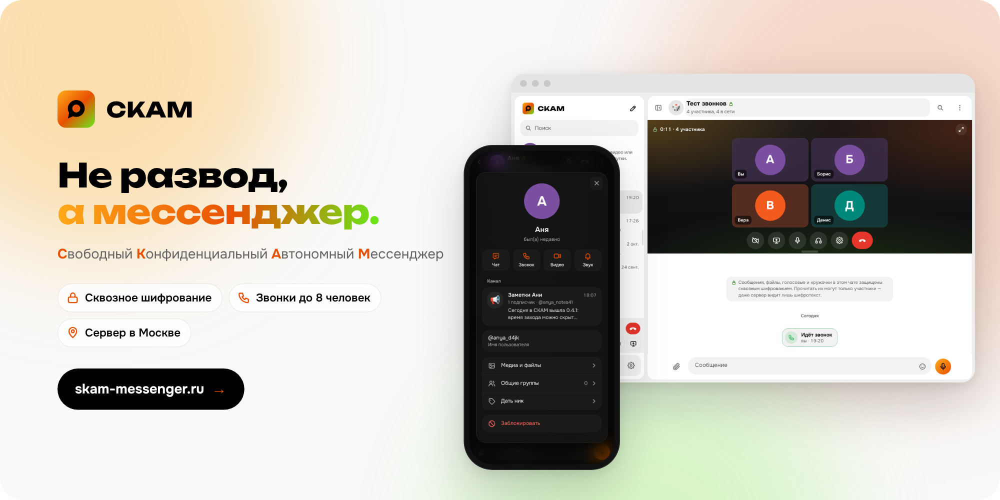

<div align="center">

<a href="https://skam-messenger.ru">
  <picture>
    <source media="(prefers-color-scheme: dark)" srcset="docs/readme/hero-dark.png">
    
  </picture>
</a>

<br>

<a href="https://skam-messenger.ru"></a>

<a href="CHANGELOG.md"></a>
<a href="LICENSE"></a>
<a href="%D0%A8%D0%98%D0%A4%D0%A0%D0%9E%D0%92%D0%90%D0%9D%D0%98%D0%95.md"></a>
<a href="server/README.md"></a>

<br>

*Новый виток в развитии русских мессенджеров и безопасный аналог МАКС,<br>который ловит даже в туалете, а не только на парковке.*

</div>

## Почему СКАМ

<table>
<tr>
<td width="50%" valign="top">

🔒 **Прочитать не сможем даже мы**<br>
Личные чаты, группы и «Избранное» шифруются прямо на вашем устройстве: сообщения, фото, файлы, голосовые и кружочки. Сервер видит только шифротекст.

</td>
<td width="50%" valign="top">

🏠 **Свой сервер в Москве**<br>
Переписка, файлы и аккаунты хранятся на собственном сервере в России, а не в чужом облаке. Вход — по коду из письма, без иностранных сервисов.

</td>
</tr>
<tr>
<td width="50%" valign="top">

📞 **Звонки как в Discord**<br>
Голос, видео и показ экрана в 1080p и 60 кадрах, группы до 8 человек. Выбор микрофона и камеры, голосовая активность и рация.

</td>
<td width="50%" valign="top">

📱 **Ничего не нужно скачивать**<br>
Открывается в браузере на телефоне и компьютере и ставится на главный экран как обычное приложение. Светлая и тёмная тема.

</td>
</tr>
</table>

## Всё, что ждёшь от мессенджера, и немного больше

- 💬 Личные чаты, группы и каналы с администраторами
- 🧠 Бот СКАМ с нейросетью Gemini — ответит на любой вопрос (включается по желанию)
- 🎤 Голосовые, ⚪ кружочки, фото, видео и файлы до 50 МБ
- 📰 Статьи как в Telegraph — со своей ссылкой и мгновенным просмотром в чате
- 📊 Опросы и викторины, анонимные и открытые
- ✨ Истории на сутки, лучшие можно закрепить в профиле
- 🎨 Свои стикеры и эмодзи — набором можно поделиться ссылкой
- 🔥 До трёх реакций на сообщение и супер-реакции для самых активных
- 🔖 «Избранное» для заметок и сохранённых сообщений
- 🗂 Папки, закреплённые чаты и поиск по всему сразу
- 🕶 «Время захода»: все, контакты или никто — скрывает сам сервер
- ✅ Официальные галочки, которые нельзя купить или подделать
- 🏷 Свои ники для контактов, «О себе» и личный канал в профиле

## Начать за минуту

1. Откройте **[skam-messenger.ru](https://skam-messenger.ru)**.
2. Введите почту — придёт код. Аккаунта ещё нет? Создадим.
3. Придумайте пароль шифрования: с ним ваши чаты откроются на любом новом устройстве.
4. На телефоне добавьте СКАМ на главный экран — и он станет приложением.

## Под капотом

**Vite + TypeScript** без фреймворков · **Supabase** на своём сервере (Postgres с RLS, Realtime, Storage, Edge Functions) · **WebRTC** для звонков · **Web Crypto** для шифрования (ECDH P-256 + AES-256-GCM).

```bash
npm install
cp .env.example .env   # адрес и publishable key вашего Supabase
npm run dev            # http://localhost:5173
```

Нужен Node.js 20.19+ или 22.12+. Подробнее — в документации:

- 🛠 **[РАЗРАБОТКА.md](РАЗРАБОТКА.md)** — запуск, настройка Supabase, база данных, структура кода
- 🔐 **[ШИФРОВАНИЕ.md](ШИФРОВАНИЕ.md)** — как устроено сквозное шифрование
- 🖥 **[server/README.md](server/README.md)** — свой сервер: сборка, резервные копии, почта
- 📝 **[CHANGELOG.md](CHANGELOG.md)** — что нового в каждой версии

## Связь

Новости — в канале «Новости СКАМ» прямо в приложении. Нашли ошибку или есть идея — кнопка «Поддержка» в профиле или письмо на [skam.messenger@yandex.com](mailto:skam.messenger@yandex.com).

<div align="center">
<br>

**Не развод, а мессенджер.** 🧡

<sub>Код открыт под лицензией [GPL-3.0](LICENSE) · [Пользовательское соглашение](https://skam-messenger.ru/terms.html) · [Политика конфиденциальности](https://skam-messenger.ru/privacy.html)</sub>

</div>
